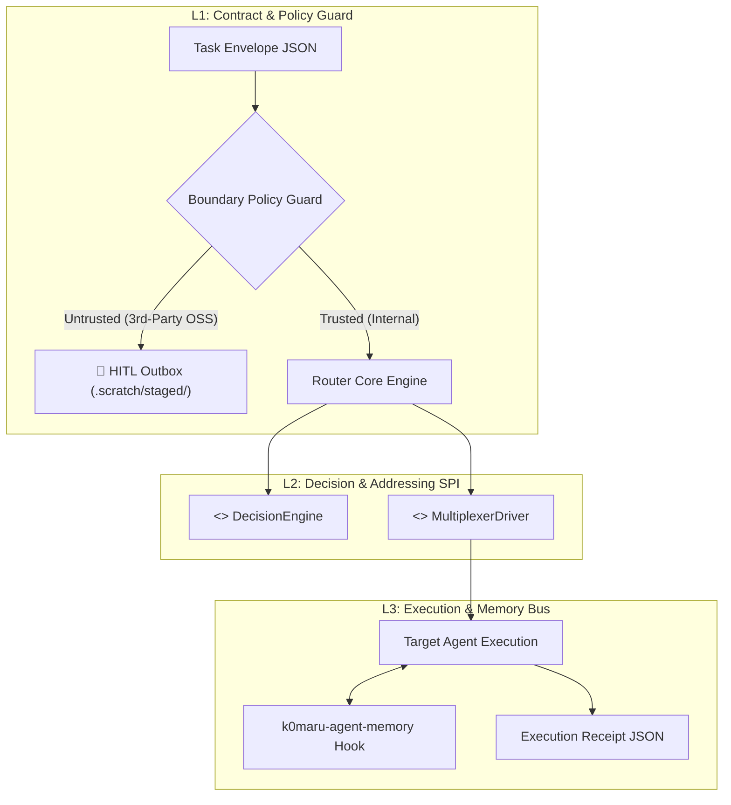

# CONTEXT.md — k0maru-agent-router Domain Terminology & System Context

This document establishes the ubiquitous language, architectural seams, and domain invariants for `k0maru-agent-router` to eliminate communication ambiguity between human engineers and AI agents.

---

## 🏛️ 1. System Vision & Scope

- **Core Vision**: The second foundational block of the **K0maru-Harness** modular matrix, serving as an independent, decoupled, cross-project portable Agent Router. It eliminates the fatigue of humans acting as "meatware clipboard relays" between repositories, guarantees strict permission isolation (preventing business agents from mutating framework code), provides human-in-the-loop staging for third-party issues (HITL Outbox), and implements zero-cognitive-load physical addressing via working directory (CWD) matching in Herdr / Tmux.
- **Value Proposition**: Existing multi-agent frameworks (such as default `teamwork-preview` or OpenHarness) are either trapped in single Git root boundaries or heavily tied to commercial SaaS accounts and intrusive runtime daemon injections. `k0maru-agent-router` offers a cleanroom, zero-daemon, single-static-binary routing microkernel adhering to UNIX philosophy.

---

## 📖 2. Domain Vocabulary

| Term | Symbol / Type | Authoritative Definition | Anti-Patterns & Common Misconceptions |
| :--- | :--- | :--- | :--- |
| **Task Envelope** | `TaskEnvelope` | Immutable JSON contract encapsulating caller, target, intent, reproduction payload, and severity | Never pass unstructured text or mutate in transit |
| **HITL Outbox** | `HitlOutbox` | Staged holding area for external 3rd-party OSS issues (`.scratch/staged/issue_xxx.md`), requiring explicit human authorization | Never push or dispatch external issues without human sign-off |
| **Boundary Policy** | `BoundaryPolicy` | Policy engine determining if a target repository is `Trusted` (internal/monorepo) or `Untrusted` (external OSS) | Never hardcode repos; evaluate via workspace config or git remote |
| **Physical Address** | `PhysicalAddress` | Normalized filesystem canonical path (`CWD` / Git root) used to identify and target agents | Never rely on human-assigned pane or agent names |
| **Session Handle** | `SessionHandle` | Multiplexer handle referencing either a `HotSession` (live idle/busy agent) or triggering `ColdSpawn` | Never assume a session is alive without probing driver |
| **Multiplexer Driver** | `MultiplexerDriver` | SPI abstraction over terminal multiplexers (`HerdrDriver`, `TmuxDriver`, `SubprocessDriver`) | Never bake raw tmux / herdr commands into business logic |
| **Decision Engine** | `DecisionEngine` | SPI abstraction for cascade routing decisions: `RuleEngine` (1ms), `VectorEngine` (15ms), or `ModelEngine` | Never block the fast path with heavy LLM calls |
| **Execution Receipt** | `ExecutionReceipt` | Structured delivery report returned by the target agent upon completing or rejecting a task | Never discard execution results silently |

---

## 🛡️ 3. Architecture Seams & Invariants

- **Domain Invariants**:
  1. *Permission Wall*: A calling agent in workspace A cannot modify code in workspace B; communication is strictly via immutable `TaskEnvelope`.
  2. *Safety Staging Gate*: External open-source dependency bugs are quarantined in `.scratch/staged/` and require explicit human clearance.
  3. *Deterministic Addressing*: Target agent lookup is based exclusively on canonical path equality (`normalize_path(agent.cwd) == normalize_path(target.cwd)`).
- **Highest Testing Seam**: Primary behavioral verification boundary is the CLI / Engine coordinator (`k0maru-router route`, `k0maru-router probe`, `k0maru-router stage`) asserting on real exit codes, filesystem artifacts, and mockable SPI drivers without synthetic bypasses.

---

## 📚 4. Reference Pointers

- Technical Specifications: [`SPEC.md`](SPEC.md)
- Agent Workflow Constitution: [`AGENTS.md`](AGENTS.md)
- Architecture Decisions: `docs/adr/`
- SecondBrain Project Note: `10_Projects/K0maru-Agent-Router.md`
