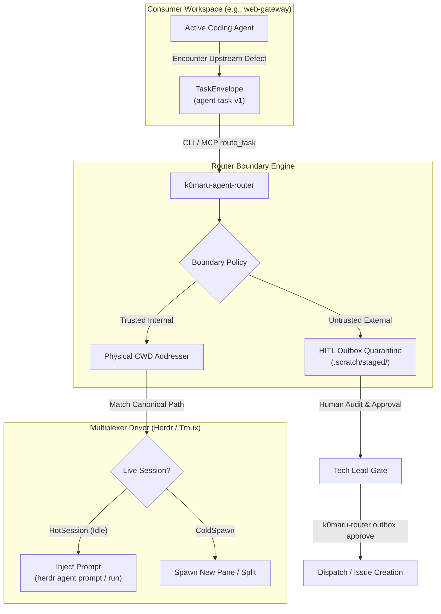

# k0maru-agent-router 🧭

[English](README.md) | [简体中文](README.zh-CN.md)

Autonomous cross-repository task routing, defect dispatch, and HITL quarantine for multi-agent coding harnesses.

`k0maru-agent-router` serves as the second core pillar of the **K0maru-Harness** modular matrix (alongside [`k0maru-agent-memory`](https://github.com/K0maru/k0maru-agent-memory)). It bridges the gap between isolated workspace agents and upstream dependencies through deterministic physical multiplexer addressing, strict boundary isolation, and human-in-the-loop outbox verification.

---

## ⚡ Core Capabilities

- **Zero-Relay Defect Auto-Routing**: Eliminates manual copy-paste clipboard friction. When a consumer workspace encounters an upstream defect, it packages the issue as a standardized `agent-task-v1` envelope and routes it directly to the target project.
- **Architectural Anti-Corruption**: Subagents are strictly restricted from mutating external repositories or dependencies directly within consumer codebases.
- **HITL Outbox Gate**: Third-party external open-source dependencies (e.g. GitHub OSS) are quarantined into reproducible Minimum Reproducible Example (MRE) drafts under `.scratch/staged/` requiring explicit human sign-off before any outbound dispatch.
- **Physical Zero-Cognitive-Load Addressing**: Discovers and addresses live agent panes strictly via canonical directory path matching (CWD / Git root) in **Herdr** and **Tmux** without requiring human-managed pane names or IDs.
- **Dual Exposure (CLI & MCP)**: Operates both as a high-performance native CLI tool (`k0maru-router`) and as a Model Context Protocol (MCP) server for Antigravity, Claude Code, and other AI agents.

---

## 🏗️ Architecture



---

## 🚀 Quick Start

### 1. Build and Install

```bash
# Prerequisites: Rust 1.75+ (Cargo)
git clone https://github.com/K0maru/k0maru-agent-router.git
cd k0maru-agent-router
cargo build --release

# The compiled binary will be located at:
./target/release/k0maru-router
```

### 2. CLI Usage

```bash
# Check system status, driver availability, and outbox metrics
k0maru-router status

# Probe active multiplexer sessions for a workspace directory
k0maru-router probe --workspace /path/to/target-project

# Route a TaskEnvelope JSON file
k0maru-router route --file task.json

# Manage staged external issue drafts
k0maru-router outbox list
k0maru-router outbox inspect --id <task_id>
k0maru-router outbox approve --id <task_id>
k0maru-router outbox reject --id <task_id>
```

### 3. MCP Server Configuration

Register `k0maru-router` in your agent MCP settings (e.g., `~/.gemini/config/mcp_config.json` or Claude Code MCP configuration):

```json
{
  "mcpServers": {
    "k0maru-router": {
      "command": "/path/to/k0maru-agent-router/target/release/k0maru-router",
      "args": ["mcp"]
    }
  }
}
```

Available MCP Tools:
- `route_task`: Ingests and routes a `TaskEnvelope` payload.
- `probe_workspace`: Probes active sessions for a given workspace path.
- `list_outbox`: Lists all staged external drafts in the quarantine area.
- `approve_issue`: Approves an external staged issue for dispatch.
- `reject_issue`: Rejects and archives an external staged issue.

---

## 📜 Task Envelope Protocol (`agent-task-v1`)

```json
{
  "$schema": "https://k0maru.dev/schemas/agent-task-v1.json",
  "id": "task_auth_jwt_01",
  "created_at": "2026-10-12T00:00:00Z",
  "caller": {
    "workspace": "/Users/k0maru3/workspace/consumer-app",
    "agent": "consumer-worker-1",
    "pane_id": "wB:p1"
  },
  "target": {
    "identifier": "internal-auth-lib",
    "workspace": "/Users/k0maru3/workspace/auth-lib",
    "is_external": false
  },
  "intent": "defect_resolution",
  "payload": {
    "title": "Fix JWT token expiration validation flaw",
    "severity": "high",
    "reproduction": {
      "snippet": "let res = auth::verify_jwt(\"expired_token_123\");\nassert_eq!(res, Err(ExpiredToken));",
      "error": "Assertion failed: left: Ok(true), right: Err(ExpiredToken)"
    },
    "expected": "verify_jwt must reject expired tokens and return Err(AuthError::ExpiredToken)."
  }
}
```

---

## 🧪 Testing & Verification

```bash
# Run comprehensive test suite (350+ tests covering protocol, drivers, outbox, and MCP)
cargo test

# Zero-warning lint check
cargo clippy --all-targets -- -D warnings

# Formatting check
cargo fmt --check
```

---

## 📄 License

MIT © K0maru
