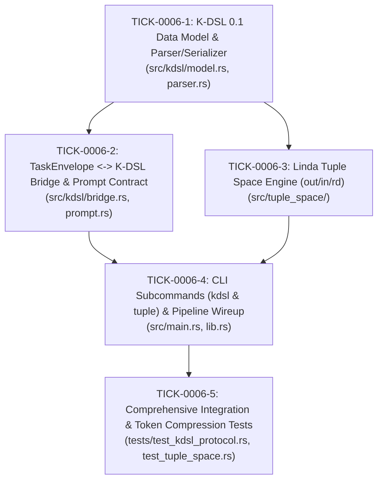

# Phase 6 Implementation Tickets: Machine-Native K-DSL Protocol and Tuple Bus

- **Specification**: `docs/spec/0006-machine-native-kdsl-protocol-and-tuple-bus.md`
- **Target Branch**: `feat/kdsl-machine-protocol`
- **Trunk**: `dev`

---

## Dependency Graph (DAG)

## Progress & Status
- [x] **TICK-0006-1**: K-DSL 0.1 Data Model & Parser/Serializer (`src/kdsl/model.rs`, `parser.rs`)
- [x] **TICK-0006-2**: TaskEnvelope <-> K-DSL Bridge & Prompt Contract (`src/kdsl/bridge.rs`, `prompt.rs`)
- [x] **TICK-0006-3**: Linda Tuple Space Engine (`src/tuple_space/mod.rs`, `tuple.rs`)
- [x] **TICK-0006-4**: CLI Subcommands (`kdsl` & `tuple`) & Pipeline Wireup (`src/main.rs`, `lib.rs`, `pipeline.rs`)
- [x] **TICK-0006-5**: Comprehensive Integration & Token Compression Tests (`tests/test_kdsl_protocol.rs`, `test_tuple_space.rs`)

---

### Ticket 1: K-DSL 0.1 Data Model & Parser/Serializer
- **ID**: `TICK-0006-1`
- **Blocked By**: None
- **Scope**:
  - Create `src/kdsl/model.rs` with `KdslPacket`, `AstCoordinate`, `AstNodeType`, `KdslOperation`, `KdslOpcode`.
  - Create `src/kdsl/parser.rs` with strict zero-loss parser for wire grammar:
    `!δ:<version>|<domain>|<path>#<rev> §AST:<type>[<id>] @OP:<op>(<target>) -> (<args>) !Σ:VERIFY(<invariants>)`
  - Implement `to_wire(&self) -> String` and `Display`.
  - Comprehensive unit tests covering valid packets, edge cases, special characters, and malformed inputs.
- **DoD**:
  - `cargo test --lib kdsl` passes 100%.
  - Round-trip `packet == KdslPacket::parse(&packet.to_wire()).unwrap()`.

---

### Ticket 2: TaskEnvelope <-> K-DSL Bridge & Prompt Contract
- **ID**: `TICK-0006-2`
- **Blocked By**: `TICK-0006-1`
- **Scope**:
  - Create `src/kdsl/bridge.rs` for converting `TaskEnvelope` to `KdslPacket` and vice versa.
  - Create `src/kdsl/prompt.rs` generating the system prompt contract snippet that forces closed-source LLMs (Claude/Gemini/GPT-4o) to respond in K-DSL wire syntax without natural language prose.
  - Unit tests verifying bidirectional conversion fidelity and token budget estimation.
- **DoD**:
  - `cargo test --lib kdsl::bridge` passes 100%.

---

### Ticket 3: Linda Tuple Space Engine (out/in/rd)
- **ID**: `TICK-0006-3`
- **Blocked By**: `TICK-0006-1`
- **Scope**:
  - Create `src/tuple_space/mod.rs` and `tuple.rs`.
  - Store tuples under `~/.k0maru/tuples/` with file-level atomic locks (using standard `std::fs` rename or lockfile).
  - Implement associative primitives:
    - `out(tuple)`: Atomically persists tuple.
    - `in(pattern)`: Finds matching tuple, claims (removes) it atomically.
    - `rd(pattern)`: Non-destructively inspects matching tuple.
    - `list(pattern)`: Queries tuples without removal.
  - Unit tests for concurrent read/write and pattern matching (by `kind`, `domain`, `task_id`).
- **DoD**:
  - `cargo test --lib tuple_space` passes 100%.

---

### Ticket 4: CLI Subcommands (kdsl & tuple) & Pipeline Wireup
- **ID**: `TICK-0006-4`
- **Blocked By**: `TICK-0006-2`, `TICK-0006-3`
- **Scope**:
  - Add `kdsl` subcommand to `clap` in `src/main.rs`:
    - `encode`, `decode`, `contract`.
  - Add `tuple` subcommand to `clap` in `src/main.rs`:
    - `out`, `in`, `rd`, `list`.
  - Integrate with `k0maru-router pipeline check` report to include `Tuple Space Bus` directory check.
- **DoD**:
  - CLI commands execute and output clean JSON or text as specified.

---

### Ticket 5: Integration & Token Compression Tests
- **ID**: `TICK-0006-5`
- **Blocked By**: `TICK-0006-4`
- **Scope**:
  - Create `tests/test_kdsl_protocol.rs` and `tests/test_tuple_space.rs`.
  - Validate end-to-end flow: Encode envelope -> K-DSL wire -> Tuple Out -> Tuple In -> Decode envelope.
  - Benchmark wire size and verify token count is `< 50 tokens` for the canonical authentication refactoring payload.
  - Ensure `cargo test` passes 100%, `cargo clippy --all-targets -- -D warnings` zero warnings.
- **DoD**:
  - All test suites green, zero clippy warnings.
